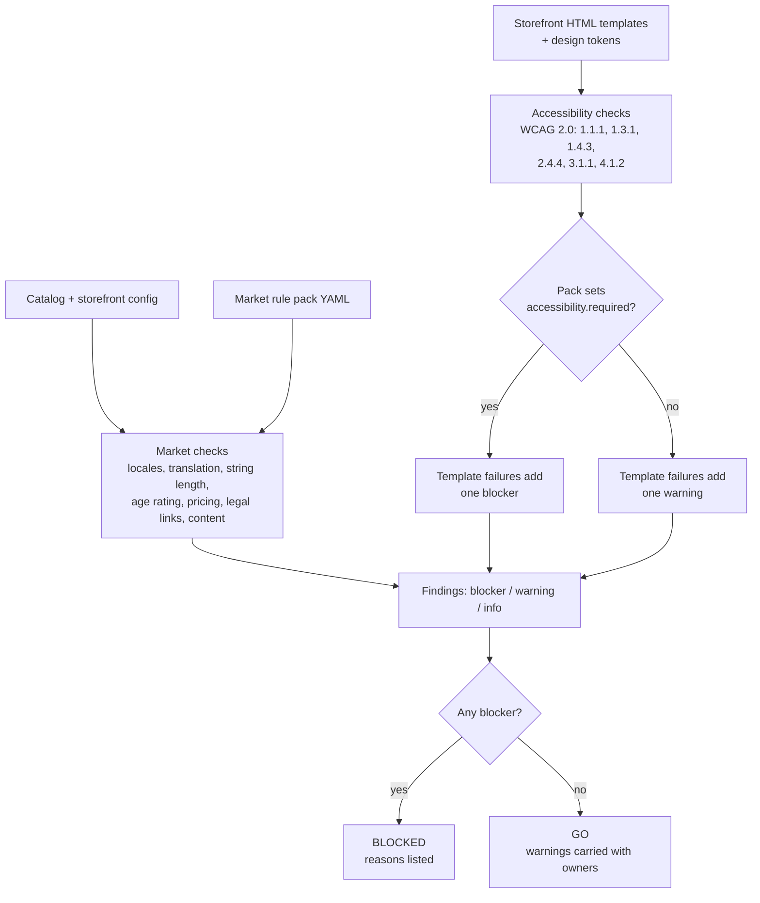

# storefront-readiness-checker

A launch readiness gate for a multi-country app storefront. It answers the question every launch review eventually comes down to: **for each market, can we ship, and if not, exactly what is blocking it and who owns the fix?**

Multi-market storefront launches rarely slip because of one big problem. They slip because of dozens of small, market-specific ones found too late: a French Canadian description nobody translated, a German title that overflows the tile, a yen price rendered with decimals, a legal page one market requires and nobody published, an app whose content rating fails a regional rule, a search field with no label. Each is easy to fix once it is visible. This tool makes them visible every night, per market, in one scorecard that legal, localization, engineering, and regional teams can all read.

- **Market rule packs in YAML.** Each market states its required locales, translation gate, string limits, rating scheme, price format, required legal links, content rules, and whether accessibility is a launch gate. Regional leads and legal own them; engineers do not need to.
- **Catalog checks per market.** Translation completeness (field level, with allowed fallbacks), string length (with display width for CJK), age rating presence and validity, price display versus the market's format, legal links, and content restrictions.
- **Automated accessibility checks** on the storefront's HTML templates and design tokens for six WCAG 2.0 success criteria that can be checked honestly from static markup. Automated checks cover only part of WCAG; manual review is required (see below).
- **A per-market scorecard**, go or blocked with reasons, in Markdown for humans and JSON for dashboards and CI gates.

**Live demo:** https://deokhwajeong.github.io/demos/storefront-readiness/ (generated from this tool's real output on the sample data)

Draws on relaunching a Smart TV app storefront localized for 53 countries with WCAG 2.0 certification.

## Sample result

The repo ships a fictional storefront (10 apps, 16 markets, 14 listing locales) with seeded defects. Current output: **8 of 16 markets go, 8 blocked.**

| Market | Status | Why |
|---|---|---|
| CA | Blocked | fr-CA translation completeness 95%, below the 98% gate; template accessibility failures (gate market) |
| DE | Blocked | Title overflows the 30 character tile; imprint link not published |
| JP | Blocked | Price shown as `¥600.00` in a zero-decimal currency |
| KR | Blocked | App missing a rating in the market's scheme |
| NL | Blocked | Content rule conflict; template accessibility failures (gate market) |
| SA | Blocked | Three apps have no ar-SA listing; content rule conflict |
| US, GB | Blocked | Template accessibility failures (gate markets) |
| BR, FR, IN, TR, ... | Go | Warnings only: policy review, soft length limit, missing alt text above the gate, likely untranslated string |

## How a market is scored



Rules worth knowing:

- **A missing title is always a blocker.** Other missing strings are warnings until the market's completeness drops below its gate, then the market is blocked.
- **Fallbacks are explicit.** `en-GB` may stand in for `en-US` if the pack says so; `fr-CA` never silently falls back to `fr-FR`.
- **Severity is policy, not code.** String limit severity, content actions (`block`, `review`, `min_rating`), and the accessibility gate all live in the pack.
- **Warnings never change status.** They exist so a market can launch with known, owned follow-ups instead of waiting on cosmetic issues.

## Accessibility: what is automated, and what is not

| SC | Checked automatically |
|---|---|
| 1.1.1 Non-text content | `` without `alt`; image inputs without alt text |
| 1.3.1 Info and relationships | Form fields without a programmatic label (fail); skipped heading levels or no h1 (advisory) |
| 1.4.3 Contrast (minimum) | Every declared foreground/background token pair against 4.5:1, or 3:1 for large text |
| 2.4.4 Link purpose | Links with no accessible name (fail); generic text such as "click here" (advisory) |
| 3.1.1 Language of page | `<html lang>` present and well formed |
| 4.1.2 Name, role, value | Buttons with no accessible name |

These checks cover a small part of WCAG 2.0 Level AA and only what is visible in static markup. They cannot judge whether alt text is useful, whether focus order works with a TV remote, or what a screen reader announces. **Passing them is an entry condition for a manual audit, not a conformance claim.** The [accessibility certification plan](docs/accessibility-certification-plan.md) covers the audit, remediation, and re-test path.

The demo page itself passes these checks; the build fails if it does not.

## Run it

Requires Python 3.12+.

```bash
python -m venv .venv && source .venv/bin/activate
pip install -e ".[dev]"

# Full scorecard (Markdown to stdout, or JSON to a file)
storefront-readiness check
storefront-readiness check --format json --out reports/scorecard.json

# One market, and fail the process if it is blocked (for CI gating)
storefront-readiness check --market DE --fail-on-blocked

# Accessibility checks only, on any HTML files or directories
storefront-readiness a11y storefront/templates --tokens storefront/tokens.json

# Build the static demo from real output
python demo/build.py --out demo/dist
```

## Tests

```bash
pytest          # 100 tests
ruff check . && ruff format --check .
```

Tests cover each market check in isolation, rule pack validation errors, the price formatter, every accessibility rule with pass and fail cases, end-to-end assertions that each seeded defect is caught in the right market, and the demo build passing its own checks. CI (GitHub Actions) also verifies the sample catalog matches its generator and publishes the scorecard to the job summary.

## Repository layout

```
data/
  storefront.yaml         UI locales and per-market legal links
  catalog.yaml            synthetic catalog (generated; see scripts/)
  rating_schemes.yaml     illustrative rating ladders
  markets/*.yaml          one rule pack per market
storefront/
  templates/*.html        sample storefront templates with deliberate issues
  tokens.json             design tokens and declared color pairs
src/storefront_readiness/
  checks/market.py        catalog checks per market
  checks/accessibility.py static WCAG checks on HTML
  checks/contrast.py      token contrast (1.4.3)
  loader.py               loading and rule pack validation
  scorecard.py            go / blocked scoring, Markdown and JSON output
  cli.py
demo/                     static demo: build script, styles, script, palette
docs/                     launch plan, localization workflow, a11y plan, pack guide
scripts/generate_sample_catalog.py   sample data and the list of seeded issues
```

## Docs

- [Multi-market launch plan template](docs/launch-plan-template.md): waves, phases, owners, exit criteria, RACI, risks.
- [Localization workflow](docs/localization-workflow.md): string freeze, translation, linguistic QA, legal review, release.
- [Accessibility certification plan](docs/accessibility-certification-plan.md): audit, remediation, re-test, certification, maintenance.
- [Market rule pack authoring guide](docs/rule-pack-authoring.md): every field, how to add a market, review checklist.

## Disclaimers

All apps, partners, strings, and URLs are fictional. Market rule packs are illustrative examples for a fictional storefront; they are not legal advice and do not describe any jurisdiction's actual requirements.

## License

[MIT](LICENSE), copyright Deokhwa Jeong.
